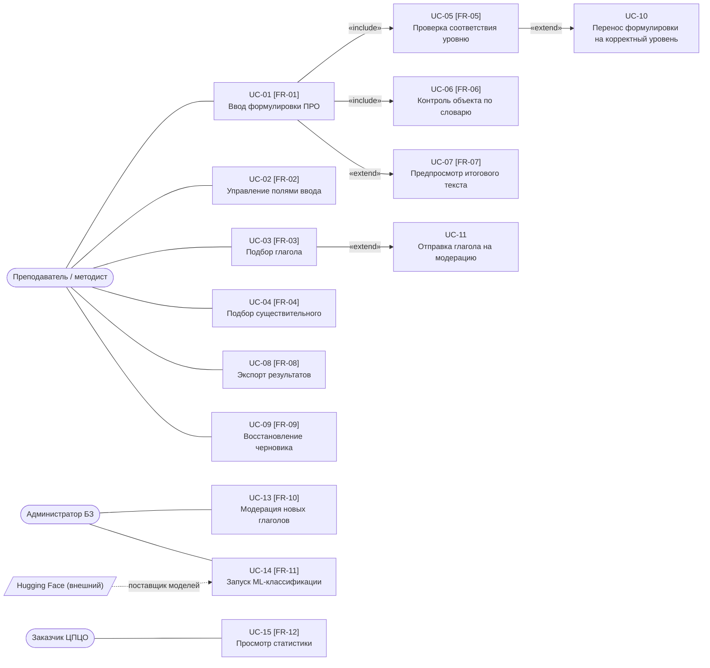

# Лабораторная работа №1. Формулирование требований к программной системе

| Поле | Значение |
|---|---|
| **Студент** | Ванюков Никита Алексеевич |
| **Группа** | РИС-23-4 |
| **Вариант** | Индивидуальный (по теме ВКР): интеллектуальная система проектирования образовательных программ на основе таксономии Блума с применением методов машинного обучения |
| **Постановка задачи** | Создание веб-инструмента, поддерживающего преподавателей и методистов в корректной и грамматически согласованной формулировке планируемых результатов обучения (ПРО) на основе таксономии Блума. Система должна обеспечивать интеллектуальную валидацию текста и использовать методы машинного обучения для развития базы знаний. Заказчик: Центр поддержки цифрового обучения Института образования НИУ ВШЭ. |
| **Репозиторий** | https://github.com/Nikitaaav/VKR_Bloom_Assistant |
| **Дата сдачи** | <28.11.2026> |

**Тема:** Анализ предметной области и формулирование требований к программной системе.

**Цель работы:** Научиться анализировать поставленную задачу, выделять заинтересованных лиц, формулировать функциональные и нефункциональные требования, представлять результаты в виде диаграммы вариантов использования.

---

## Краткое описание системы

Разрабатываемая система — веб-приложение для преподавателей и методистов вузов, помогающее формулировать планируемые результаты обучения (ПРО) в программах учебных дисциплин (ПУД) на основе таксономии Блума. Программа предлагает глаголы и существительные из базы знаний (с сортировкой по частотности), автоматически склоняет словосочетания и контролирует соответствие формулировки выбранному уровню. Итоговый текст формируется в реальном времени и экспортируется в DOCX и TXT. Новые глаголы, добавленные пользователями, проходят модерацию администратора и пакетно классифицируются моделью машинного обучения. Система развивает прототип, реализованный автором в 2026 г., доводя его до уровня регулярной эксплуатации.

---

## Оглавление

1. [Перечень заинтересованных лиц (стейкхолдеров)](#1-перечень-заинтересованных-лиц-стейкхолдеров)
2. [Перечень функциональных требований](#2-перечень-функциональных-требований)
3. [Диаграмма вариантов использования](#3-диаграмма-вариантов-использования)
4. [Перечень нефункциональных требований](#4-перечень-нефункциональных-требований)
5. [Перечень сделанных предположений](#5-перечень-сделанных-предположений)
6. [Чек-лист самопроверки](#6-чек-лист-самопроверки)

---

## 1. Перечень заинтересованных лиц (стейкхолдеров)

Выделено 4 стейкхолдера: три внутренних (пользователь, администратор, заказчик) и один внешний (сторонний сервис — репозиторий предобученных моделей). Внешний стейкхолдер учтен, так как система зависит от него при загрузке моделей для офлайн-классификации глаголов.

| ID | Стейкхолдер | Роль | Интересы / цели | Влияние |
|----|-------------|------|-----------------|---------|
| SH-01 | Преподаватель / методист | Пользователь | Быстро формулировать корректные и грамматически согласованные ПРО без ручного перебора глаголов; получать готовый текст для вставки в ПУД | Высокое |
| SH-02 | Администратор базы знаний | Администратор | Актуальность справочников глаголов и существительных, модерация новых слов, контроль качества рекомендаций ML-модели | Среднее |
| SH-03 | Центр поддержки цифрового обучения НИУ ВШЭ | Заказчик | Единообразие и повышение качества ПУД в университете, возможность наблюдать статистику использования системы | Высокое |
| SH-04 | Внешний репозиторий моделей (Hugging Face) | Внешний сервис | Поставка предобученных языковых моделей (DeepPavlov/rubert-base-cased) для офлайн-обучения и переобучения классификатора | Низкое |

---

## 2. Перечень функциональных требований

Сформулировано 12 функциональных требований, покрывающих всех ключевых стейкхолдеров. Где возможно, указана измеримость (лимиты, форматы, периодичность). Приоритизация выполнена по методологии MoSCoW.

| ID | Требование | Стейкхолдер | Приоритет (MoSCoW) | Обоснование |
|----|------------|-------------|---------------------|-------------|
| FR-01 | Пользователь может вводить и редактировать формулировки ПРО для каждого из шести уровней таксономии Блума; длина формулировки - до 500 символов | SH-01 | Must | Базовая функция конструирования результатов; без неё продукт не решает ключевую задачу |
| FR-02 | Пользователь может добавлять неограниченное количество полей ввода на один уровень и удалять ранее добавленные поля | SH-01 | Must | Для дисциплины обычно требуется несколько результатов на один уровень |
| FR-03 | Система должна предлагать глаголы из справочника по первым введённым буквам, сортируя варианты по частотности использования | SH-01 | Must | Ускоряет ввод и снижает число методических ошибок |
| FR-04 | Система должна предлагать существительные, сочетающиеся с выбранным глаголом, и автоматически склонять их по правилам русского языка | SH-01 | Must | Устраняет грамматические ошибки (например, «оперировать теорию» вместо «оперировать теорией») |
| FR-05 | Система должна определять уровень таксономии введённого глагола и при несоответствии выбранному уровню предлагать переместить формулировку | SH-01, SH-03 | Must | Основной механизм методологического контроля |
| FR-06 | Система должна предупреждать пользователя, если объект формулировки характерен для других уровней (например, «эссе» - уровни 5–6) | SH-01, SH-03 | Should | Контроль семантической корректности, выявленный заказчиком на приёмке прототипа |
| FR-07 | Система должна формировать итоговый текст ПРО для предпросмотра и обновлять его в реальном времени | SH-01 | Must | Пользователь сразу видит результат, пригодный для вставки в ПУД |
| FR-08 | Пользователь может экспортировать итоговый текст в форматы DOCX и TXT (UTF-8); имя файла содержит название дисциплины | SH-01 | Must | ПУД оформляется в Word; TXT сохраняется для совместимости с прошлой версией |
| FR-09 | Система должна автоматически сохранять черновик локально в браузере (localStorage) не реже раза в 30 секунд и восстанавливать его при открытии | SH-01 | Should | Защита от потери текста при случайном закрытии вкладки |
| FR-10 | Администратор должен иметь возможность одобрять, отклонять и исправлять глаголы пользователей, а также редактировать справочники | SH-02 | Must | Глагол попадает в основной справочник только после модерации - требование заказчика |
| FR-11 | Система должна периодически классифицировать глаголы из очереди модерации ML-моделью и передавать администратору рекомендуемый уровень | SH-02 | Should | Использование методов машинного обучения (тема ВКР); ускоряет модерацию, но право финального решения остается за человеком |
| FR-12 | Заказчик может просматривать статистику использования системы и частотности выбора глаголов | SH-03 | Could | Позволяет заказчику оценивать внедрение и качество базы знаний |

**Ограничение (Won't):** Автоматическая генерация формулировок ПРО средствами нейросети в реальном времени исключена из текущей итерации по решению заказчика. Акцент системы сделан на правильности подбора слов по уровням, а не на генерации связного текста.

---

## 3. Диаграмма вариантов использования

На диаграмме представлены все стейкхолдеры: преподаватель, администратор и заказчик выступают как основные акторы, а внешний сервис Hugging Face - как вторичный актор ML-процесса. Связь с требованиями осуществляется через указание ID в названии варианта использования.

### Диаграмма

### Описание ключевого сценария

| Поле | Значение |
|---|---|
| **Use Case** | UC-05 [FR-05] Проверка соответствия глагола уровню таксономии |
| **Актор** | Преподаватель / методист (SH-01) |
| **Предусловие** | Пользователь находится на главной странице, выбран уровень таксономии, в поле введён глагол |
| **Основной поток** | 1. Пользователь вводит глагол в поле уровня → 2. Система нормализует слово и ищет его в справочнике ClassifiedVerbs → 3. Система сравнивает уровень глагола с выбранным уровнем поля → 4. Уровни совпадают → 5. Система отображает зеленую индикацию и разблокирует подбор существительных (UC-04) |
| **Постусловие** | Статус формулировки - «корректна»; формулировка участвует в итоговом тексте (UC-07) |
| **Альтернативный поток A** | 4a. Глагол найден, но относится к другому уровню: система показывает желтое предупреждение с указанием корректного уровня и предлагает «Переместить на уровень N» (UC-10); при согласии значение переносится |
| **Альтернативный поток B** | 4b. Глагол отсутствует в справочнике: система сообщает, что глагол не найден, и предлагает отправить его на модерацию администратору (UC-11) |

## 4. Перечень нефункциональных требований 

Выбраны пять наиболее значимых для данной системы архитектурных свойств. Каждое требование измеримо и снабжено критерием приёмки.

| ID | Категория | Требование | Метрика / критерий приёмки | Почему выбрано |
|----|-----------|------------|----------------------------|----------------|
| NFR-01 | Performance | Быстрый отклик интерактивных подсказок при вводе | Отклик автодополнения ≤ 1 с (p95) при 30 одновременных пользователях | Автодополнение - самая частая операция; задержка свыше 1 с разрушает эффект «умного» ввода |
| NFR-02 | Availability | Доступность сервиса и восстановление после сбоев | Доступность ≥ 99,5 % в месяц; ежесуточное резервное копирование БД; восстановление ≤ 1 ч (RTO ≤ 1 ч) | Потеря данных критична в пиковые периоды (конец семестра); фиксируется согласованный уровень надежности |
| NFR-03 | Security | Защита административной функциональности и данных | Все соединения по HTTPS (TLS ≥ 1.2); доступ к админ-панели по логину/паролю; сервер не хранит персональные данные | Фокус защиты - админка и транспорт, так как регистрация обычных пользователей исключена (A-02) |
| NFR-04 | Usability | Освоение системы без предварительного обучения | Пользователь формулирует первый корректный ПРО не более чем за 10 минут без внешней документации | Целевая аудитория - преподаватели без технической подготовки; критерий проверяется на приёмке |
| NFR-05 | Scalability | Расширение базы знаний и нагрузки без изменения кода | Добавление записей через админ-панель без изменения кода; рост до 100 пользователей не увеличивает отклик более чем на 20 % | База знаний растёт постоянно; масштабирование не должно требовать переработки системы |

**Что отброшено:** интернационализация (A-03), мобильная оптимизация под смартфоны (сценарий — настольный/планшетный), real-time требования к ML-модулю (пакетный режим, A-04).

---

### 5. Перечень сделанных предположений

Выделено пять предположений, которые напрямую влияют на архитектуру, нефункциональные требования и объём работ.

| ID | Предположение | Влияние на требования |
|----|---------------|-----------------------|
| A-01 | Система эксплуатируется на территории РФ и доступна без средств обхода блокировок | Формулируются требования к доступности (NFR-02) и условиям эксплуатации |
| A-02 | Регистрация пользователей не требуется: черновики хранятся локально (localStorage), на сервере - только обезличенные данные | Отказ от серверных сессий для обычных пользователей; снимаются требования к защите персональных данных (NFR-03) |
| A-03 | Язык интерфейса и формулировок — только русский | Двуязычная локализация исключена; упрощается интерфейс и база знаний |
| A-04 | ML-модуль работает в пакетном режиме (не в реальном времени), финальное решение о метке принимает администратор | Архитектура модуля - offline-скрипты; к отклику ML не предъявляется жестких требований (FR-11) |
| A-05 | Система работает с короткими формулировками ПРО (до 500 символов), а не с полными текстами программ | Ограничение FR-01; определяются объёмы хранения и требования к экспорту (FR-08) |

---

## 6. Чек-лист самопроверки

- [x] README содержит ФИО, группу, вариант (индивидуальный, по теме ВКР), постановку задачи
- [x] Все таблицы имеют ID (SH-, FR-, A-, NFR-)
- [x] Каждое FR привязано хотя бы к одному стейкхолдеру
- [x] Каждый Use Case на диаграмме соответствует FR (UC-10 и UC-11 — расширения UC-05 и UC-03)
- [x] Есть минимум один внешний стейкхолдер (SH-04, Hugging Face)
- [x] Все NFR измеримы (числа, проценты, сроки)
- [x] Исходник диаграммы закоммичен (use-case.mmd)
- [x] Нет требований вида «система должна быть удобной/надёжной» без метрики
